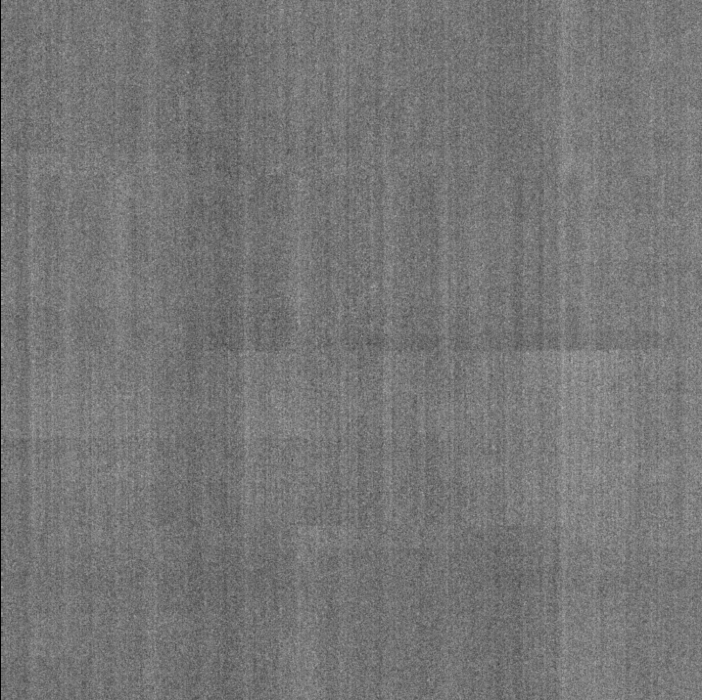
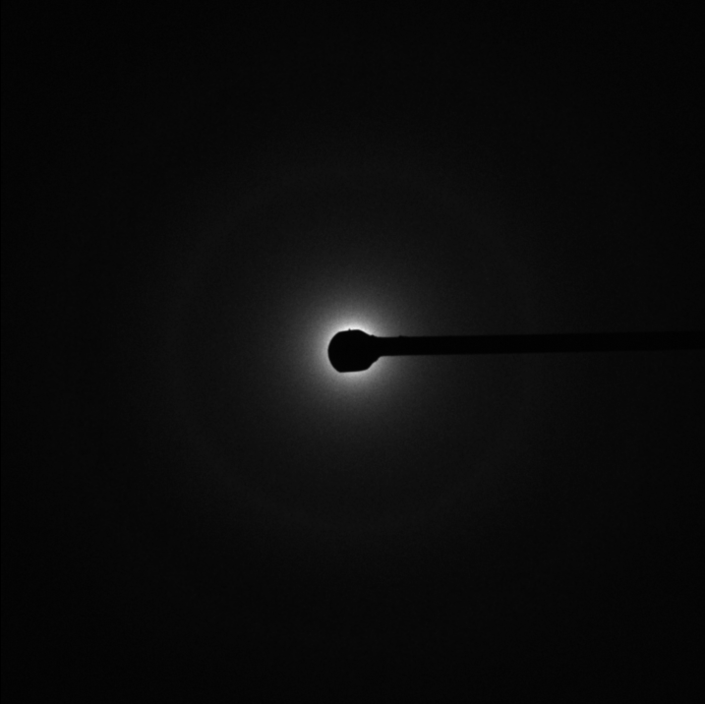
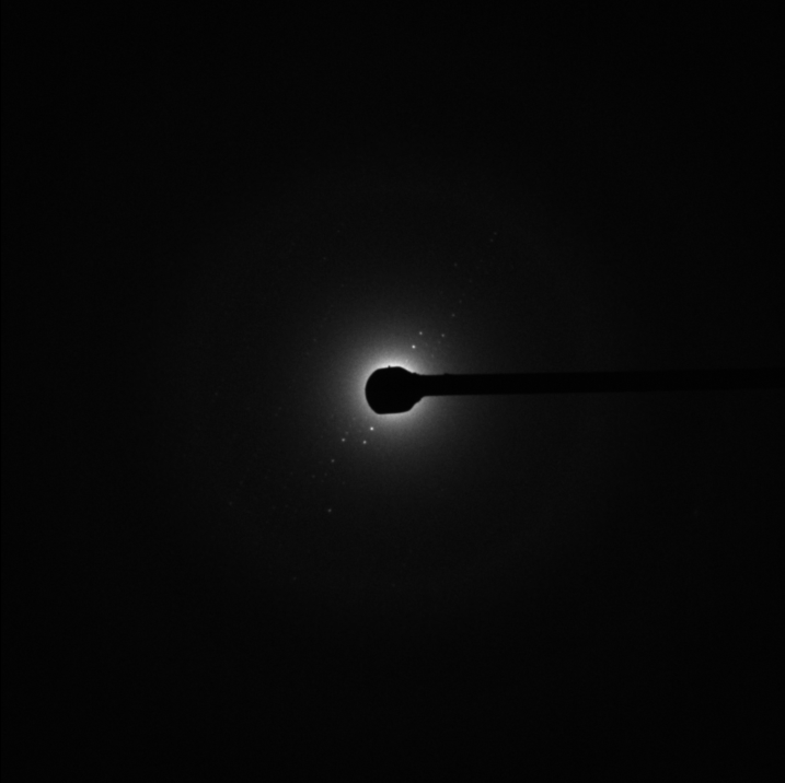
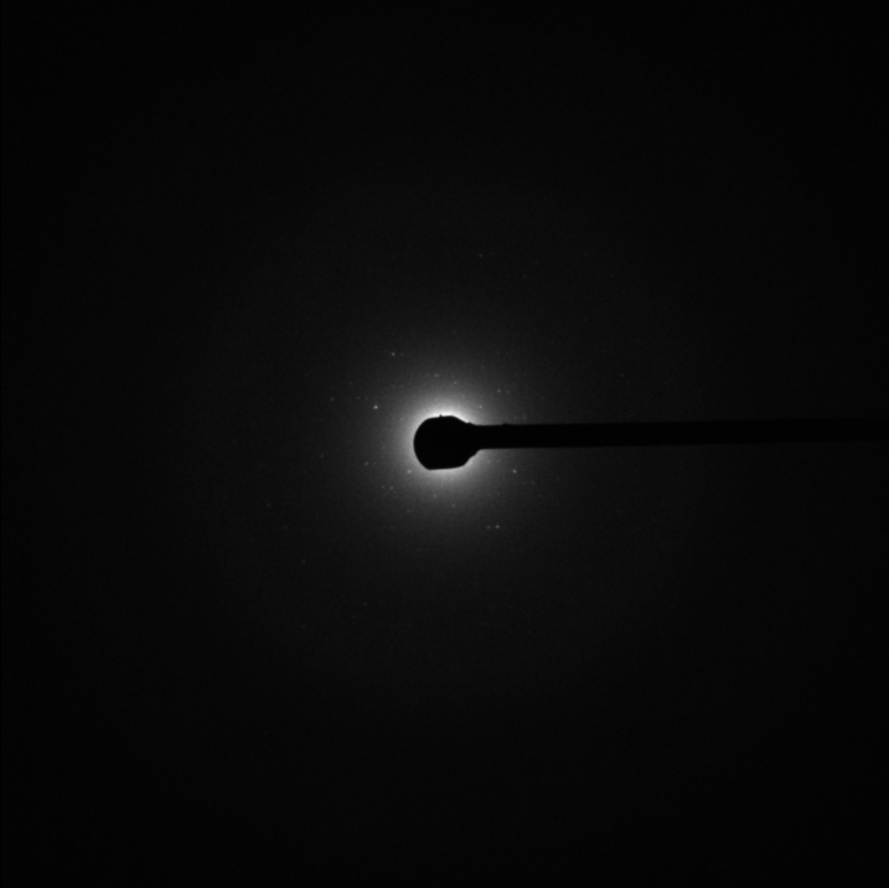

# Image labeller

This app is used to look through an image stack and mark each frame green or red (good or bad quality). Installation and usage instructions are given below.

## Installation

1. If you don't have Python already, download it from [python.org/downloads](https://www.python.org/downloads/) and run the installer. You can leave the default options as they are. For ChromiumOS, check the instructions below then come back to here.
2. I would recommend using VSCode to view and run the code. You can download it from here [code.visualstudio.com](https://code.visualstudio.com/). For ChromiumOS, check the instructions below then come back to here.
3. Create a folder somewhere on your computer where the code will be stored. Then, go to VSCode and select File > Open and open that folder.
4. In VSCode, select Terminal > New Terminal in the top bar. This should open a terminal at the bottom of your screen.
5. In the terminal, run the following command (copy it into the terminal and press enter). This will download the code from GitHub.
   ```bash
   git clone https://github.com/lucapanconi/q-loop-tests
   ```
6. In the terminal, run the following lines. This will create a Python "environment" which stores all of the code required to run the program. Every time you open a new terminal window or re-open VSCodeRun, you will need to run `source .venv/bin/activate` again.
   ```bash
   python3 -m venv .venv
   source .venv/bin/activate
   pip install -r requirements.txt
   ```

## Get Python and VS Code on ChromeOS / ChromiumOS

I haven't used ChromiumOS myself, but from what I've read online this is how you can install VSCode and Python. Any problems, let me know.

1. Open Settings > About ChromeOS > Developers and turn on Linux development environment. A terminal app should appear when it finishes.
2. In that Terminal, run the following (copy it in and press enter):
   ```bash
   sudo apt update
   sudo apt install -y python3 python3-venv python3-tk
   ```
3. Download the `.deb` version of VS Code from [code.visualstudio.com](https://code.visualstudio.com/). In the Files app, move it into Linux files, then double-click it to install.
4. Open VSCode from the app launcher.

Your data drive is hidden from Linux by default. In the Files app, right-click the drive and choose Share with Linux. It should then appear under `/mnt/chromeos/removable/`.

## Label frames

If everything goes well, you should now be able to run the `image_labeller.py` Python file using the following command (in terminal):
```bash
python image_labeller.py
```

Drag the image file onto the window and it will open (this may take a few seconds).

Use the Left/Right arrow keys to move between frames and press the Up arrow to switch between green (good) and red (bad).

If you want to navigate to a specific frame, you can click on the frame number box and type the number in.

When you press "Done", it will save all the progress you've made so far, so you can close the image and re-open later. This will create an `.npy` file which stores your labels. You can send this `.npy` file over to me when you're done.

## General guide to labelling frames

Any frames which show no diffraction pattern (white spots) are "bad" and should be labelled red. This include noisy frames that look like TV static. Any frames which show some diffraction pattern should be labelled "good" green. Some examples are given below:

**Bad**

 

**Good**

 

If you're unsure, mark it as green and we can go through later and check.